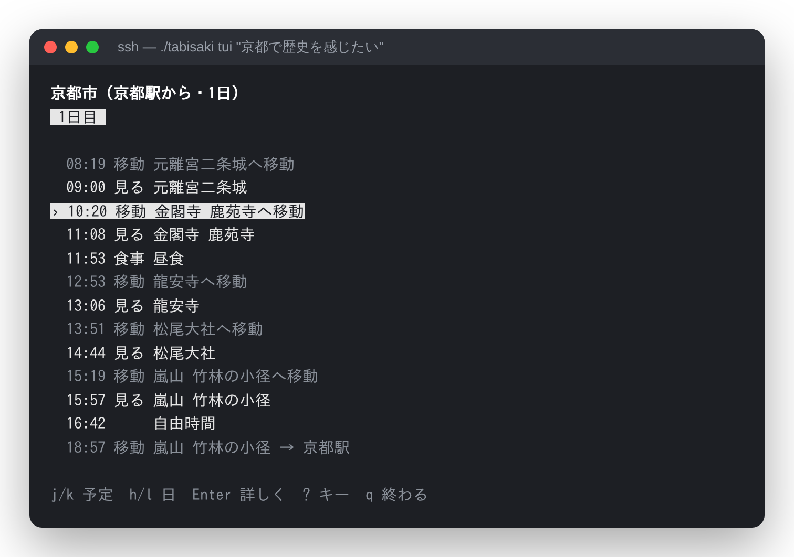

# 旅さき
[][1]
[][2]
[][3]
[](LICENSE)

> 月日は百代の過客にして、行かふ年も又旅人也。

-- <cite>松尾芭蕉『おくのほそ道』, 1702</cite>

旅さきは、「行きたいこと」から旅程をつくる旅行プランナーです。端末（SSH）から使えます。「温泉と海をゆっくり楽しみたい」のような文から、行き先・立ち寄る順番・移動時間・営業時間を考えて、その日に実際に回れる旅程を組みます。

<p align="center">
  
</p>

## Features

* 文で頼むだけで旅程になる（「京都で歴史を感じたい」「温泉に入りつつ海も見たい」）
* 開館時間・最終入場・移動時間・食事・帰着時刻を守って時刻を割り当てる
* 全国のエリア **1,371** か所・スポット **54,101** か所を収録(10月27日現在)（[知識ベース](docs/knowledge-base.md)）
* 定番と穴場の割合、混雑・天気・日没・季節に合わせた順番
* 日帰り・複数日・片道・周遊に対応
* AI が出した場所も、収録の候補と照らし合わせてから使う（無い場所は旅程に入らない）
* API キーが無くても動く（移動時間は距離からの目安、行き先は収録データから）
* 旅程を英語でも出せる（`--lang=en`。翻訳は [docs/i18n.md](docs/i18n.md)）

## 端末（SSH）での機能

* `./tabisaki plan` で旅程を Markdown・テキスト・JSON で出す
* `./tabisaki tui` で、端末の中でキーボードだけで見る（j/k・h/l・Enter・q）
* 旅程をカレンダーへ（Web 版は .ics、端末は `./tabisaki sync` で CalDAV に直接）。声で希望を伝えることもできる（[カレンダーと声](docs/calendar-and-voice.md)）
* `./tabisaki plan --local` で、手元の LLM（Ollama など）に行き先を選ばせる（[docs/local-llm.md](docs/local-llm.md)）
* `./tabisaki similar "清水寺"` で似たスポットを探し、`./tabisaki kb extract --region=関東` で地域のぶんだけ切り出す（[docs/kb-extract.md](docs/kb-extract.md)）
* `./tabisaki api` で、手元用の API サーバー（`POST /v1/plan`、[docs/api.md](./docs/api.md)）を立てる。Docker でも動く
* Node.js 22 以上だけで動き、`npm install` も外への通信も要らない（`--local` のときは手元の LLM へだけ）

## Install

```sh
git clone git@github.com:shitianliang1000-alt/tabisaki-app.git
cd tabisaki-app
./tabisaki plan "温泉と海をゆっくり楽しみたい" --days=2
```

端末から使う: [docs/cli-usage.md](docs/cli-usage.md)

スポットに別名・営業時間・季節・写真を足す（出典つき）: [docs/spot-data.md](docs/spot-data.md)

手元の API サーバー（Docker）: [docs/self-hosting.md](docs/self-hosting.md)

携帯アプリ（Android の apk・iOS）: [docs/mobile.md](docs/mobile.md)

Web 版は <https://tabisaki-github-io.shitianliang1000.workers.dev/>（PHP 版 <https://tabisaki.site.je/>）

## Development

### [しくみとファイルの構成](docs/architecture.md)

### [Web 版の開発・試験・公開](docs/web-development.md)

### [AI と API キー](docs/ai-and-keys.md)

### [知識ベース](docs/knowledge-base.md)

### [多言語対応と翻訳](docs/i18n.md)

### [外のデータの取り口](docs/data-providers.md)

開発に参加するときは [CONTRIBUTING.md](CONTRIBUTING.md) を読んでください。これからの計画は [docs/roadmap.md](docs/roadmap.md)、版の付けかたは [docs/releases.md](docs/releases.md) と [CHANGELOG.md](CHANGELOG.md)、脆弱性の知らせかたは [SECURITY.md](SECURITY.md) です。スポットの情報がまちがっていたら [Issue の「スポット情報の訂正」](../../issues/new?template=spot_report.md) から知らせてください。

## Related

* [OpenStreetMap][4]: 地図と、一部の座標の出どころ（ODbL 1.0）
* [Wikidata][5] / [Wikipedia][6]: 名前・座標・説明・写真の出どころ
* [Leaflet][7]: Web 版の地図
* [国土数値情報][8]: 観光資源・文化施設・鉄道のデータ

## License

旅さきのプログラムは [PolyForm Noncommercial License 1.0.0](LICENSE) で配っています。**商用利用はできません。** 個人の利用・学習・研究・趣味の改変や、非営利の団体での利用はできます。2026-10-27 より前に公開した版は The Unlicense のままです。

収録データ（`kb/`）のうち外から取り込んだ部分は、それぞれの提供元の条件に従います（たとえば OpenStreetMap 由来は ODbL、Wikipedia の文は CC BY-SA）。同梱の部品（`vendor/` の Leaflet・フォントなど）も、それぞれのライセンスです。国土数値情報の「非商用」のデータや、Yahoo! JAPAN の API で取った座標など、**再配布してよいかを確かめていないもの**があります。公開・再配布の前に [docs/data-licenses.md](docs/data-licenses.md) を読んでください。

  [1]: https://github.com/shitianliang1000-alt/tabisaki-app/actions/workflows/test.yml
  [2]: https://github.com/shitianliang1000-alt/tabisaki-app/actions/workflows/kb-check.yml
  [3]: https://tabisaki-github-io.shitianliang1000.workers.dev/
  [4]: https://www.openstreetmap.org/copyright
  [5]: https://www.wikidata.org/
  [6]: https://ja.wikipedia.org/
  [7]: https://leafletjs.com/
  [8]: https://nlftp.mlit.go.jp/ksj/
